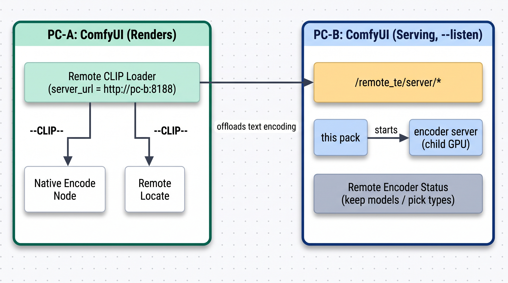
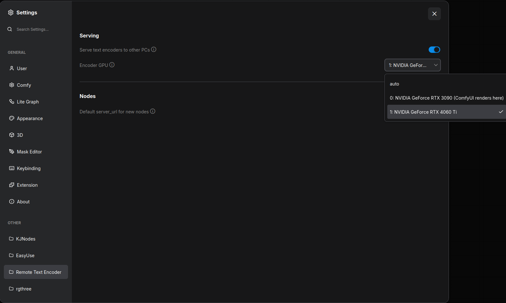
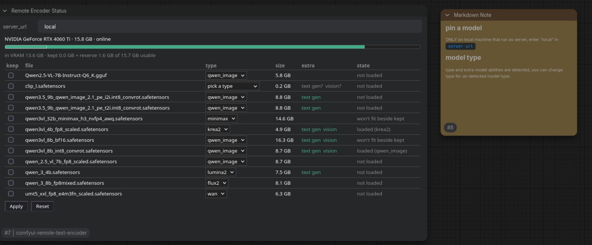
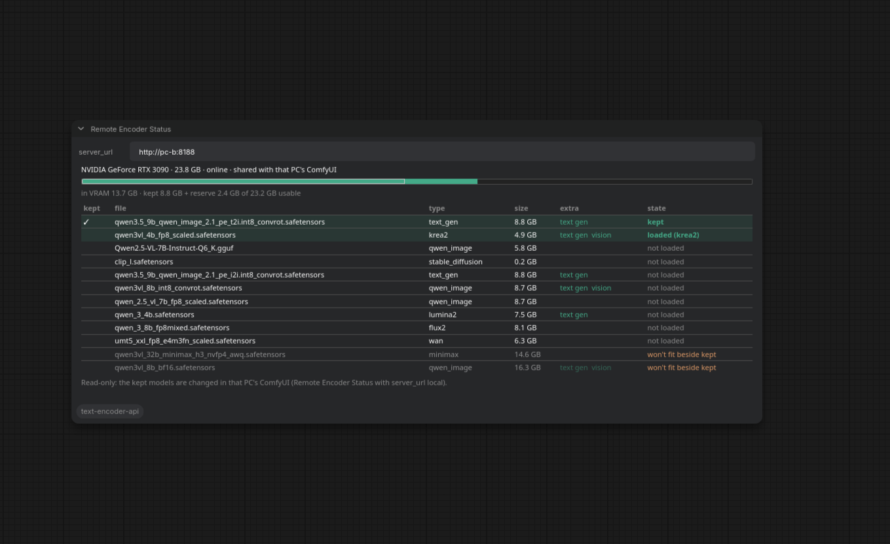

# comfyui-remote-text-encoder

Offload the text encoder to another GPU: on a different machine, or a second GPU in the same box.

Text encoders take a large chunk of VRAM. Modern image models come with ever larger text encoders, and video models even more (MiniMax H3's encoder alone is 15 GB). This node pack helps people who have
an older GPU somewhere at home: run ComfyUI on that PC as a text encoder server, and your main ComfyUI on the other box
renders without ever loading the encoder.

- Results match a local `CLIPLoader` exactly when both PCs have the same kind of GPU (and differ by about 1-2 of 255
  per pixel across GPU generations).
- The model's own encode nodes keep working unchanged (`CLIPTextEncode` and the model-specific ones): only the loader
  is swapped.
- Encoders load on demand on the server; the ones you use all the time can be kept loaded.
- Support text encoder type detection.
- Use remote clip node same way as default comfyui clip loader, for text encoding, text gen, and vision tasks.

## How it works



PC-B's ComfyUI starts a small encoder server as a separate process on the GPU you choose, and shares its API through
ComfyUI's own port: nothing else to open or configure. On PC-A, Remote CLIP Loader outputs a stand-in `CLIP`. When an
encode node calls `tokenize` and `encode`, the text goes to PC-B, which runs ComfyUI's real tokenize + encode on its
loaded model and sends the conditioning back. The performance penalty is minimum as the traffic sent over LAN is very small.

One PC with two GPUs works the same way: see [One PC with two GPUs](#one-pc-with-two-gpus).

## Requirements

- A recent ComfyUI on both PCs and the same version of this pack on both.
- PC-B: an NVIDIA GPU, or a Mac with Apple Silicon (limited: see [macOS](#macos-apple-silicon-as-pc-b)), and ComfyUI
  started with `--listen` so PC-A can reach it.
- Both PCs on the same local network (there is no authentication: don't expose PC-B to the internet).
- Tested on Linux, Windows, and on a Mac as PC-B.

## Install

On **both PCs**, install the pack and restart ComfyUI. Either:

- **ComfyUI Manager**: search for **Remote Text Encoder** and install it, or `comfy node install comfyui-remote-te`
  with comfy-cli.
- **git**: clone the whole repository into ComfyUI's `custom_nodes`:

  ```bash
  cd ComfyUI/custom_nodes
  git clone https://github.com/fixed-42/comfyui-remote-text-encoder
  ```

## Start the server (PC-B)

### Method 1; Use the settings

**Settings > Remote Text Encoder**: turn on **Serve text encoders to other PCs** and pick the **Encoder GPU**. `auto`
picks a card ComfyUI doesn't render on. The server starts, stops and moves at once, no restart needed.



### Method 2; Start with environment variables

| Variable | Meaning |
|---|---|
| `REMOTE_TE_SERVE=1` | serve at startup (overrides the setting) |
| `REMOTE_TE_GPU=1` | the encoder GPU: a CUDA device number (as `--cuda-device` counts), a UUID, or part of the name (`4060`) |
| `REMOTE_TE_LOG=debug` | log every request in ComfyUI's console |

```bash
REMOTE_TE_SERVE=1 python main.py --listen
```

### Remote Encoder Status on PC-B: 

Shows list of text encoder available, allow user see the status and VRAM utilization, and pin a models, or pick types

Add a **Remote Encoder Status** node on PC-B with `server_url` = `local`:

- **keep**: tick it and click **Apply** to keep a model loaded (pin it). Other models load when a workflow asks for
  them and make room for each other. **Useful to prevent Comfyui memory management idle offloading**.
- **type**: Select a model type; when same text encoder support multiple diffusion model.
  how the file is loaded, as in `CLIPLoader`. It is detected from the model file with one time scan; for a file it doesn't know
  ("pick a type"), choose one and click **Apply**. PC-B remembers it, and Remote CLIP Loader offers it first.
- **extra**: what the file can do besides encoding, checked in the background after startup: `text gen` (ComfyUI's
  Generate Text on a Remote CLIP, e.g. for prompt enhancement) and `vision` (reads images: Remote Locate). The check
  loads each file once; on a slow disk, turn off Settings > Remote Text Encoder > **Check what each encoder can do in
  the background**, and a file is checked when it is first used for Generate Text or Remote Locate.



Kept models and picked types are changed only on PC-B, and saved in `ComfyUI/user/remote_te/`.

## How to use (PC-A)

1. Replace `Load CLIP` (`CLIPLoader`) with **Remote CLIP Loader**.
2. Set `server_url` to PC-B's ComfyUI, e.g. `http://pc-b:8188` (its name or IP address), or `local` on the serving PC
   itself. A default for new nodes can be set in Settings > Remote Text Encoder.
3. Pick the `type` (as in `CLIPLoader`; only the types PC-B's files can be loaded as are offered), then the `model`
   (PC-B's files for that type; `(kept)` / `(loaded)` show what's ready). Or connect your diffusion model loader's
   `MODEL` to **auto_detect**: at Run it sets the type and an encoder file that suits the model and fits PC-B's card.
4. Connect its `CLIP` to the model's usual encode node.

A **Remote Encoder Status** node on PC-A shows what PC-B has (read-only):



Sample workflows in [sample_workflows/](sample_workflows/):

- `remote_te_demo_k2.json`: Krea 2 with Remote CLIP Loader (a switch goes back to a local `CLIPLoader`), and
  Generate Text refining the prompt on PC-B.
- `remote_te_locate_sample.json`: Remote Locate makes a mask from `img/group_photo.png`.

## One PC with two GPUs

The same ComfyUI renders on one card and encodes on the other:

1. Install the pack once.
2. Settings > Remote Text Encoder: turn on serving and set **Encoder GPU** to the card ComfyUI doesn't render on
   (the menu marks the render card). `--listen` is only needed if other PCs should use it too.
3. In your workflows, set Remote CLIP Loader's `server_url` to `local`.

If the encoder GPU is also the card ComfyUI renders on, models that aren't kept unload after 60 s unused while
ComfyUI holds models of its own, so ComfyUI gets the VRAM back. Kept models stay loaded.

## macOS (Apple Silicon) as PC-B

a Mac can serve encoders to another PC. Install this custom node pack.

1. **Desktop version of listen on the network**: add `--listen 0.0.0.0` to Desktop's startup arguments and restart Desktop.
2. **Let ComfyUI's Python through the macOS firewall**, or other PCs get an empty reply. Either System Settings >
   Network > Firewall > Options: "Allow incoming connections", or allow the real Python behind Desktop's
   `.venv/bin/python3` (a link):

   ```bash
   PY=$(realpath "<install folder>/ComfyUI/.venv/bin/python3")
   sudo /usr/libexec/ApplicationFirewall/socketfilterfw --add "$PY"
   sudo /usr/libexec/ApplicationFirewall/socketfilterfw --unblockapp "$PY"
   ```

3. Settings > Remote Text Encoder: turn on serving. **Encoder GPU** offers only `auto` (the Mac's chip, e.g.
   `Apple M4`). On a slow or external disk, turn off the background check (it loads every file once).
4. On PC-A, set `server_url` to `http://<mac address>:8188`. To check the connection from PC-A:
   `curl http://<mac address>:8188/remote_te/server/health`.

Memory on a Mac:

- The encoder can use Metal's recommended working set, about 3/4 of RAM (about 12 GB on a 16 GB Mac), minus 10% kept
  free while encoding. Larger files show "too big for this card".
- The Mac's own ComfyUI shares that memory: after it renders, models that aren't kept unload after 60 s unused.
  **Keep** the ones you use (Remote Encoder Status with `server_url` = `local`).
- Generate Text is very slow.
- Logs: Desktop's Logs tab (`[remote_te server]` lines), `~/Library/Logs/Comfy Desktop/app.log`, and
  `ComfyUI/user/remote_te/server.log`.

## Extra

- **Remote Locate** finds something in an image with a vision encoder (`qwen3vl_4b`, `qwen3vl_8b`) and outputs a
  **mask** and **bounding boxes** (for SAM3 Detect, DrawBBoxes, CropByBBoxes). Feed the mask into your inpainting or
  edit workflow, whichever CLIP loader (local or remote) that workflow uses. Sample:
  `sample_workflows/remote_te_locate_sample.json` with `sample_workflows/img/group_photo.png`.
- **Generate Text**: ComfyUI's own Generate Text node runs on a Remote CLIP for files with `text gen`, e.g. to enhance
  a prompt on PC-B. Language models made for it, such as Qwen-Image 2.1's prompt enhancers (Qwen3.5), are listed under
  the type `text_gen`.

## Troubleshooting

- `this ComfyUI does not serve text encoders`: turn on serving on PC-B (Settings, or `REMOTE_TE_SERVE=1`; mind the
  spelling) and start it with `--listen`.
- `server.py, gpus.py not found`: only the `comfyui_remote_te` subfolder was installed; clone the whole repository.
- A version warning on PC-A: install the same version of this pack on both PCs.
- A Mac as PC-B gives an empty reply, and its log shows `OSError: [Errno 22] Invalid argument` per connection: the
  macOS firewall cuts the connection. Allow ComfyUI's Python through it (see [macOS](#macos-apple-silicon-as-pc-b)).
- The encoder server's log: ComfyUI's console on PC-B (`[remote_te server]`) and `ComfyUI/user/remote_te/server.log`.

## License

GPL-3.0, like ComfyUI. **Made for the GPU poor**: free for everyone. If you use it commercially, please consider getting
in touch or sponsoring.
