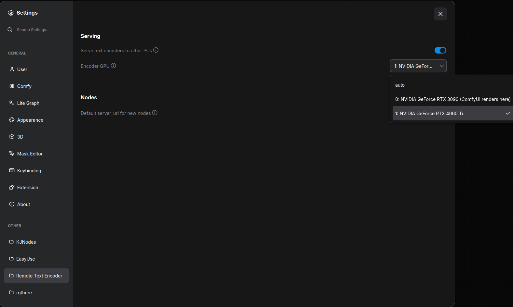
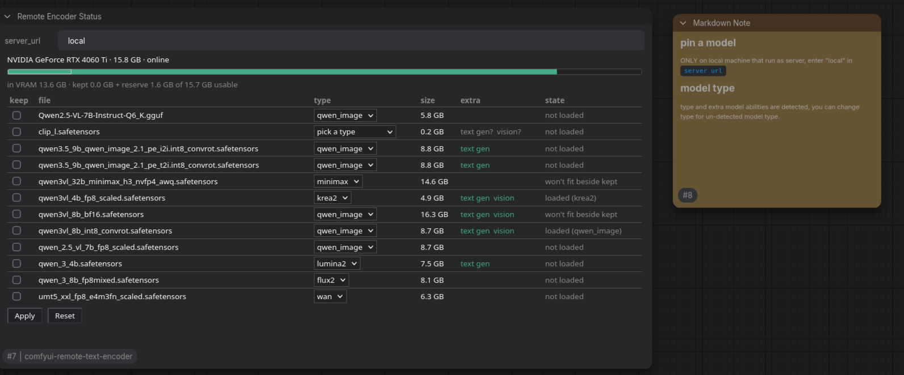
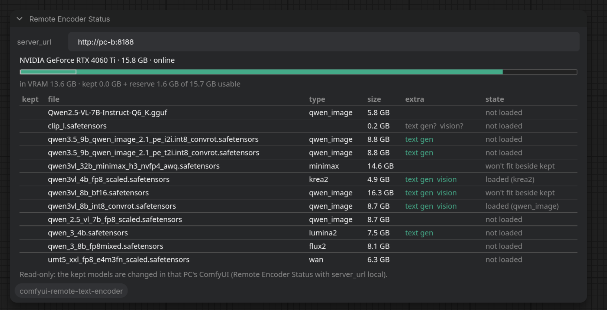

# comfyui-remote-text-encoder

Offload the text encoder to another GPU: on a different machine, or a second GPU in the same box.

Text encoders take a large chunk of VRAM. Modern image models come with ever larger text encoders (Qwen-Image, Flux.2,
Krea 2, Z-Image), and video models even more (MiniMax H3's encoder alone is 15 GB). This node pack helps people who have
an older GPU somewhere at home: run ComfyUI on that PC as a text encoder server, and your main ComfyUI on the other box
renders without ever loading the encoder.

- Results match a local `CLIPLoader` exactly when both PCs have the same kind of GPU (and differ by about 1-2 of 255
  per pixel across GPU generations).
- The model's own encode nodes keep working unchanged (`CLIPTextEncode` and the model-specific ones): only the loader
  is swapped.
- Encoders load on demand on the server; the ones you use all the time can be kept loaded.

## How it works

```
PC-B: ComfyUI (serving, --listen)                          PC-A: ComfyUI (renders)
  this pack ─ starts ─► encoder server (child, its GPU)       Remote CLIP Loader (server_url = http://pc-b:8188)
  /remote_te/server/* ── forwarded to it ◄─────────────────     ──CLIP──► the model's own encode node
  Remote Encoder Status: keep models, pick types               ──CLIP──► Remote Locate
```

PC-B's ComfyUI starts a small encoder server as a separate process on the GPU you choose, and shares its API through
ComfyUI's own port: nothing else to open or configure. On PC-A, Remote CLIP Loader outputs a stand-in `CLIP`. When an
encode node calls `tokenize` and `encode`, the text goes to PC-B, which runs ComfyUI's real tokenize + encode on its
loaded model and sends the conditioning back.

One PC with two GPUs works the same way: see [One PC with two GPUs](#one-pc-with-two-gpus).

## Requirements

- A recent ComfyUI on both PCs (tested with 0.44) and the same version of this pack on both.
- PC-B: an NVIDIA GPU, and ComfyUI started with `--listen` so PC-A can reach it.
- Both PCs on the same local network (there is no authentication: don't expose PC-B to the internet).
- Tested on Linux. Windows is planned for the next release.

## Install

On **both PCs**, clone the whole repository into ComfyUI's `custom_nodes` and restart ComfyUI:

```bash
cd ComfyUI/custom_nodes
git clone https://github.com/fixed-42/comfyui-remote-text-encoder
```

ComfyUI Manager: in a couple of days.

## Start the server (PC-B)

### Method 1; Use the settings

**Settings > Remote Text Encoder**: turn on **Serve text encoders to other PCs** and pick the **Encoder GPU**. `auto`
picks a card ComfyUI doesn't render on. The server starts, stops and moves at once, no restart needed.



### Method 2; Start with environment variables

| Variable | Meaning |
|---|---|
| `REMOTE_TE_SERVE=1` | serve at startup (overrides the setting) |
| `REMOTE_TE_GPU=1` | the encoder GPU: a CUDA device number (as `--cuda-device` counts), a UUID, or part of the name (`4060`) |
| `REMOTE_TE_LOG=debug` | log every request in ComfyUI's console |

```bash
REMOTE_TE_SERVE=1 REMOTE_TE_GPU=1 python main.py --listen
```

### Remote Encoder Status on PC-B: keep models, pick types

Add a **Remote Encoder Status** node on PC-B with `server_url` = `local`:

- **keep**: tick it and click **Apply** to keep a model loaded (pin it). Other models load when a workflow asks for
  them and make room for each other.
- **type**: how the file is loaded, as in `CLIPLoader`. It is detected from the file; for a file it doesn't know
  ("pick a type"), choose one and click **Apply**. PC-B remembers it, and Remote CLIP Loader offers it first.
- **extra**: what the file can do besides encoding, checked in the background after startup: `text gen` (ComfyUI's
  Generate Text on a Remote CLIP, e.g. for prompt enhancement) and `vision` (reads images: Remote Locate).



Kept models and picked types are changed only on PC-B, and saved in `ComfyUI/user/remote_te/`.

## How to use (PC-A)

1. Replace `Load CLIP` (`CLIPLoader`) with **Remote CLIP Loader**.
2. Set `server_url` to PC-B's ComfyUI, e.g. `http://pc-b:8188` (its name or IP address), or `local` on the serving PC
   itself. A default for new nodes can be set in Settings > Remote Text Encoder.
3. Pick the `model` (PC-B's encoder files; `(kept)` / `(loaded)` show what's ready) and the `type`.
4. Connect its `CLIP` to the model's usual encode node.

A **Remote Encoder Status** node on PC-A shows what PC-B has (read-only):



Sample workflows in [sample_workflows/](sample_workflows/):

- `remote_te_demo_k2.json`: Krea 2 with Remote CLIP Loader (a switch goes back to a local `CLIPLoader`), and
  Generate Text refining the prompt on PC-B.
- `remote_te_locate_sample.json`: Remote Locate makes a mask from `img/group_photo.png`.

## One PC with two GPUs

The same ComfyUI renders on one card and encodes on the other:

1. Install the pack once.
2. Settings > Remote Text Encoder: turn on serving and set **Encoder GPU** to the card ComfyUI doesn't render on
   (the menu marks the render card). `--listen` is only needed if other PCs should use it too.
3. In your workflows, set Remote CLIP Loader's `server_url` to `local`.

## Extra

- **Remote Locate** finds something in an image with a vision encoder (`qwen3vl_4b`, `qwen3vl_8b`) and outputs a
  **mask** and **bounding boxes** (for SAM3 Detect, DrawBBoxes, CropByBBoxes). Feed the mask into your inpainting or
  edit workflow, whichever CLIP loader (local or remote) that workflow uses. Sample:
  `sample_workflows/remote_te_locate_sample.json` with `sample_workflows/img/group_photo.png`.
- **Generate Text**: ComfyUI's own Generate Text node runs on a Remote CLIP for files with `text gen`, e.g. to enhance
  a prompt on PC-B.

## Troubleshooting

- `this ComfyUI does not serve text encoders`: turn on serving on PC-B (Settings, or `REMOTE_TE_SERVE=1`; mind the
  spelling) and start it with `--listen`.
- `server.py, gpus.py not found`: only the `comfyui_remote_te` subfolder was installed; clone the whole repository.
- A version warning on PC-A: install the same version of this pack on both PCs.
- The encoder server's log: ComfyUI's console on PC-B (`[remote_te server]`) and `ComfyUI/user/remote_te/server.log`.

## License

GPL-3.0, like ComfyUI. Made for the GPU poor: free for everyone. If you use it commercially, please consider getting
in touch or sponsoring.
